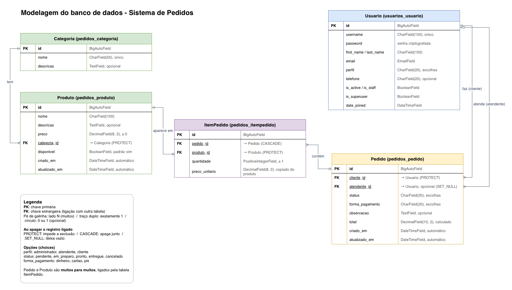

# Sistema de Pedidos

Trabalho prático da disciplina GAC116 - Programação Web (UFLA).

## Integrantes
- Arienne Alves Navarro
- Thales Rodrigues Resende

## Descrição
Sistema de pedidos para lanchonetes que ainda usam comanda de papel. O administrador
cadastra o cardápio e os usuários, o cliente faz o pedido pelo celular e acompanha o
preparo, e o atendente atualiza o andamento de cada pedido até a retirada no balcão.

O back-end é uma API em Django, que também oferece o painel administrativo. O front-end
é feito em React e consome essa API.

## Tecnologias
**Back-end**
- Python 3
- Django 4.2
- Django REST Framework
- Simple JWT (autenticação por token)
- django-cors-headers
- Django Jazzmin (tema do painel administrativo)
- SQLite

**Front-end**
- React
- Vite
- React Router
- Axios
- Bootstrap 5

## Instalação
Pré-requisitos: Python 3.9 ou superior, Node.js 20 ou superior e Git.

Clone o repositório:
```
git clone https://github.com/ariennenavarro/sistema-pedidos-lanchonete.git
cd sistema-pedidos-lanchonete
```

### Back-end
Crie e ative o ambiente virtual:
```
python -m venv venv
source venv/bin/activate      # Linux/Mac
venv\Scripts\activate         # Windows
```

Instale as dependências, crie o banco de dados e um usuário administrador:
```
pip install -r requirements.txt
python manage.py migrate
python manage.py createsuperuser
```

### Front-end
```
cd frontend
npm install
```

## Execução
O sistema precisa dos dois servidores rodando ao mesmo tempo, cada um em um terminal.

Back-end (na raiz do projeto, com o ambiente virtual ativo):
```
python manage.py runserver
```

Front-end (na pasta `frontend`):
```
npm run dev
```

| Endereço | O que é |
| --- | --- |
| http://localhost:5173 | Sistema para clientes e atendentes |
| http://127.0.0.1:8000/admin | Painel administrativo |
| http://127.0.0.1:8000/api/ | API |

Para usar o sistema, cadastre no painel administrativo as categorias, os produtos e pelo
menos um usuário com perfil **Atendente**. Clientes podem criar a conta pela própria tela
de cadastro.

## Principais funcionalidades
**Acesso**
- Cadastro, login e logout
- Três perfis de usuário com permissões diferentes: administrador, atendente e cliente
- Tema claro e escuro, com a escolha salva no navegador
- Interface responsiva

**Cliente**
- Cardápio com filtro por categoria, mostrando só os produtos disponíveis
- Carrinho com quantidades, forma de pagamento e observação
- Acompanhamento dos pedidos com atualização automática do status
- Cancelamento de pedidos ainda pendentes

**Atendente**
- Painel com os pedidos separados em pendentes, em preparo e prontos
- Avanço do status do pedido, com registro de quem o atendeu
- Cancelamento de pedidos

**Administrador**
- Painel administrativo com tema Jazzmin
- Cadastro de usuários, categorias, produtos e pedidos
- Filtros, busca e edição rápida nas listas
- Total do pedido calculado automaticamente, com o preço de cada item registrado no momento da compra

## Perfis e permissões
| Ação | Cliente | Atendente | Administrador |
| --- | --- | --- | --- |
| Ver o cardápio | só produtos disponíveis | só produtos disponíveis | todos |
| Cadastrar e editar produtos | não | não | sim |
| Fazer pedidos | sim | não | não |
| Ver pedidos | só os próprios | todos | todos |
| Atualizar o status | não | sim | sim |
| Cancelar | os próprios, se pendentes | sim | sim |

As permissões são verificadas na API. As telas do React só escondem o que cada perfil não
pode usar.

## Fluxo do pedido
```
Pendente ──> Em preparo ──> Pronto ──> Entregue
    │             │
    └─────────────┴──> Cancelado
```
O pedido não pode pular etapas. O atendente que inicia o preparo fica registrado como
responsável, e o cliente acompanha as mudanças pela tela "Meus pedidos", que se atualiza
sozinha.

## Modelagem do banco de dados


Pedido e Produto são ligados pela tabela ItemPedido, que guarda a quantidade e o preço
de cada produto no momento do pedido. O total do pedido é calculado automaticamente pela
soma dos itens.

## Estrutura do projeto
```
sistema-pedidos-lanchonete/
├── config/                 # configurações do Django (settings e urls)
├── usuarios/               # app de usuários e perfis
│   ├── models.py           # modelo Usuario
│   ├── admin.py            # tela de usuários no admin
│   ├── serializers.py      # conversão dos dados para a API
│   ├── permissions.py      # permissões por perfil
│   ├── views.py            # cadastro e dados do usuário logado
│   └── urls.py             # rotas de autenticação
├── pedidos/                # app do cardápio e dos pedidos
│   ├── models.py           # Categoria, Produto, Pedido e ItemPedido
│   ├── admin.py            # telas do admin com filtros
│   ├── serializers.py
│   ├── views.py            # API do cardápio e dos pedidos
│   └── urls.py
├── frontend/               # aplicação React
│   └── src/
│       ├── components/     # barra de navegação, tema e rota protegida
│       ├── context/        # usuário logado
│       ├── pages/          # telas do sistema
│       ├── services/       # comunicação com a API
│       └── utils/          # formatação de valores e datas
├── docs/                   # diagrama da modelagem
├── manage.py
└── requirements.txt
```

## Endpoints da API
| Método | Endereço | Descrição |
| --- | --- | --- |
| POST | `/api/auth/cadastro/` | Cria uma conta de cliente |
| POST | `/api/auth/login/` | Faz login e devolve o token |
| GET | `/api/auth/me/` | Dados do usuário logado |
| GET | `/api/categorias/` | Lista as categorias |
| GET | `/api/produtos/` | Lista os produtos |
| GET, POST | `/api/pedidos/` | Lista e cria pedidos |
| POST | `/api/pedidos/<id>/status/` | Atualiza o status (atendente) |
| POST | `/api/pedidos/<id>/cancelar/` | Cancela um pedido pendente (cliente) |

## Organização do repositório
- `main`: versão estável
- `develop`: integração das funcionalidades
- `feature/...`: uma branch por parte do sistema (`feature/usuarios`, `feature/pedidos`,
  `feature/api` e `feature/frontend`)

As mensagens de commit seguem o padrão de commits semânticos (`feat`, `fix`, `docs`, `chore`).